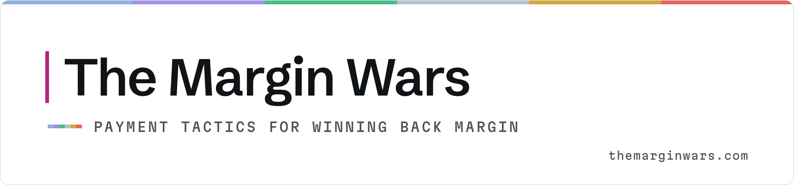
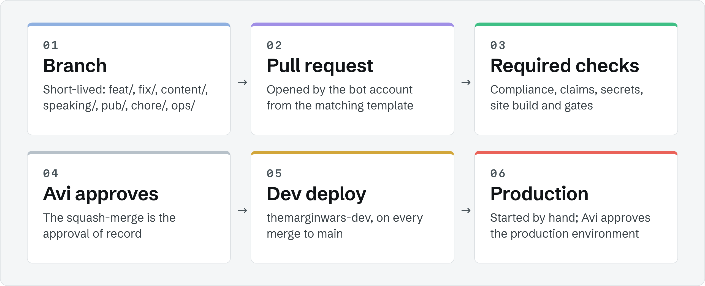

<picture>
  <source media="(prefers-color-scheme: dark)" srcset=".github/assets/banner-dark.png">
  <source media="(prefers-color-scheme: light)" srcset=".github/assets/banner-light.png">
  
</picture>

<p>
  <a href="https://github.com/MarginWars/themarginwars/actions/workflows/check.yml"></a>
  <a href="https://github.com/MarginWars/themarginwars/actions/workflows/nightly.yml"></a>
  <a href="https://github.com/MarginWars/themarginwars/actions/workflows/deploy.yml"></a>
  <a href="https://themarginwars.com"></a>
</p>

**Nobody loses margin on the rate. You lose it in the line items nobody owns.**

This repository is the source of truth for [The Margin Wars](https://themarginwars.com): the website, every
outbound post, issue, pitch and speaker pack, and the governance that decides when any of it goes live.
Run by Avi and Anitha, Pacific Time. Agents prepare. People sign.


## What this repo runs

| Area | What it covers | Where |
| --- | --- | --- |
| Site | themarginwars.com: pages, Pages Functions (contact, assistant, measurement), Workers and the release gates | [`site/`](site), [`qa/`](qa) |
| Content pipeline | Every outbound item as one file with front-matter, the weekly calendar, and the facts each number must cite | [`content/`](content), [`publications/`](publications), [`facts/`](facts), [`schemas/`](schemas) |
| Channels | LinkedIn, X, Substack and the Briefing, published from merged items at their scheduled time | [`content/`](content), [`ops/publish/`](ops/publish) |
| Speaking and media | The CFP register, one pack per event, the speaker kit, press passes and pitches | [`speaking/`](speaking), [`media/`](media) |
| Pipeline and research | Lead-generation schema and playbooks (never records), the source library and research notes | [`pipeline/`](pipeline), [`research/`](research) |
| Governance | Approvals, standing permissions, rulesets, decision records and the agent roster | [`ops/`](ops), [`docs/adr/`](docs/adr), [`AGENTS.md`](AGENTS.md), [`.github/`](.github) |

**GitHub drives every channel** ([ADR-0001](docs/adr/0001-github-source-of-truth.md)). An item changes only by
pull request, and a merge approved by the code owner is the approval of record.

## Quickstart

Python 3.13 and Node 24. From the repo root:

```bash
pip install -r requirements.txt && python3 -m playwright install --with-deps chromium
bash site/build.sh            # build site/dist and qa-out/dist.md5
bash site/build.sh check      # prove site/src is a fixed point of the layers
qa/run_gates.sh static        # compliance, front-matter and limits, claims, links, standards lock, functions
qa/run_gates.sh browser       # text overflow, spacing and symmetry (Chromium core) on the built site
npx markdownlint-cli2         # Markdown style (config in .markdownlint-cli2.jsonc)
```

## Repo map

| Path | What lives there |
| --- | --- |
| [`site/src/`](site/src) | The site source of record (generated pages, committed as source) |
| [`site/layers/`](site/layers) | The ordered build layers that produce `site/src`: copy, UI, route briefs, about, feeds, normalize, buildout, marketing and brand assets |
| [`site/build.sh`](site/build.sh) | `dist` (default) builds `site/src` into `site/dist`, the only deploy artefact; `full` reruns every layer; `check` proves `site/src` is a fixed point |
| [`site/functions/`](site/functions) | Cloudflare Pages Functions (contact, escalations, measurement, assistant). Runtime secrets are Pages project secrets, never here |
| [`site/workers/`](site/workers) | The rate-limit and contact-mailer Workers (config templates only) |
| [`qa/`](qa) | Release gates: compliance, claims, character limits, links, spacing, text overflow, symmetry and the cross-engine matrix |
| [`content/`](content) | Channel posts, threads and profile copy for LinkedIn, X and Substack; `content/calendar/` holds the weekly calendar (the approval unit) |
| [`publications/`](publications) | The Briefing (invite-only, monthly), essays and route briefs |
| [`speaking/`](speaking) | `register.yml` (the single CFP register), one pack per event and the speaker kit |
| [`media/`](media) | Press-pass and media pitches, and the media kit |
| [`pipeline/`](pipeline) | Lead-generation schema and playbooks only. No personal records, ever |
| [`research/`](research) | Source library and research notes |
| [`facts/`](facts) | `approved.yml` and `assumptions.yml`: every number in outbound copy maps here |
| [`brand/`](brand) | Brand docs, logo and channel assets |
| [`ops/`](ops) | Approvals, standing permissions, agent schedules, runbooks, environments and the publish spec |
| [`docs/adr/`](docs/adr) | Architecture decision records |
| [`schemas/`](schemas) | JSON Schemas for front-matter, the calendar and the publish ledger |
| [`.github/`](.github) | Workflows, issue and pull request templates, labels, code owners and the repo brand assets |

## How changes flow

<picture>
  <source media="(prefers-color-scheme: dark)" srcset=".github/assets/flow-dark.png">
  <source media="(prefers-color-scheme: light)" srcset=".github/assets/flow-light.png">
  
</picture>

1. An agent (the bot account) opens a pull request from a short-lived branch: `feat/`, `fix/`, `content/`,
   `speaking/`, `pub/`, `chore/` or `ops/`.
2. CI runs every required check: `compliance`, `frontmatter-limits`, `claims`, `links-docs`, `secrets`,
   `standards-lock`, `functions`, `site-build` and `site-gates`.
3. Avi, the code owner, reviews. **The squash-merge is the approval** for exactly what is in the pull request.
4. A merge to `main` deploys the site to **dev** (`themarginwars-dev`). Production runs only when started by hand
   and waits on the `production` environment, which Avi approves.
5. Channels publishes merged items at their scheduled Pacific Time and writes the live URL to the `ledger` branch.

## Governance and policies

| Document | What it sets |
| --- | --- |
| [CONTRIBUTING.md](CONTRIBUTING.md) | Branches, Conventional Commits, pull requests and outbound item front-matter |
| [SECURITY.md](SECURITY.md) | What never goes in this public repo, where secrets live and how to report a problem |
| [AGENTS.md](AGENTS.md) | The agent roster and each agent's approval boundary |
| [ops/approvals.md](ops/approvals.md) | The approvals register for gated names, fees and new public claims |
| [ops/standing-permissions.md](ops/standing-permissions.md) | Standing permissions (SP-n) and their scope |
| [docs/adr/](docs/adr) | Decision records, starting with [ADR-0001](docs/adr/0001-github-source-of-truth.md) |
| [ops/runbooks/](ops/runbooks) | Deploy, rollback, publish and the [16 Nov launch runbook](ops/runbooks/launch-2026-11-16.md) |
| [ops/publish/scheduler-spec.md](ops/publish/scheduler-spec.md) | How merged items are scheduled and published |

Questions about the work: [hello@themarginwars.com](mailto:hello@themarginwars.com).

## Licence

Copyright © 2026 The Margin Wars. All rights reserved; see [LICENSE](LICENSE). Public so the work is open to
read, not open to reuse.
